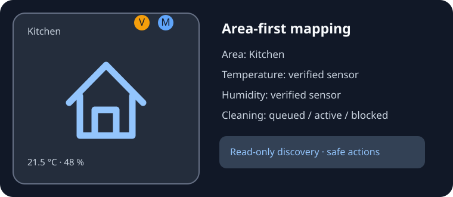

# Room Control Card

A **Home Assistant custom dashboard card** with validated entity bindings, room navigation,
and corner indicators for vacuuming, mopping, bedtime, extractor and temperature/humidity.

**Status:** v0.3.0 development pilot. The JavaScript bundle and unit tests are working
locally, but **visual rendering and touchscreen interactions have not yet been validated on
Home Assistant OS**. Do not install on a production Overview without a Dashboard Test pilot.



This is an illustrative preview. The card still requires a **Dashboard Test** pilot
for real HAOS rendering, room bindings and touch gestures.

## Optional central Room Control Profiles integration (experimental)

The source for an optional companion Home Assistant integration now lives under
[`companion/`](companion/README.md). It adds a UI-based, persisted room-profile
manager (Area selection, per-room entity pickers and optionally confirmed robot
segment metadata), publishing a read-only `sensor.room_control_profiles` entity.

**The HACS Dashboard card does NOT install this Python integration.** For an
initial pilot, follow the manual VM installation instructions in
[the companion README](companion/README.md); restart HA and add the integration
under Settings → Devices & services. It must be separately packaged and
validated before offering installation through HACS as an integration.

With the companion installed and a single marked profiles sensor available,
the card can automatically use centrally stored room profiles:

```yaml
type: custom:room-control-card
room: kitchen
```

If several profile sensors exist or you want the current template-sensor approach,
use `profiles_entity: sensor.your_profile_sensor` explicitly. Local card overrides
still win. **No shared profile can enable device actions**; physical actions remain
disabled unless a card has `enable_actions: true`. Cassandra's existing room
verification, queues and notifications are not modified.

This feature has offline tests but not yet a real HAOS runtime pilot. Test on
**Dashboard Test** before changing Overview.

## v0.3.0 mapping wizard and shared profiles

This pilot adds:

- A guided Area → climate candidates → entity verification workflow in the graphical editor.
- A **read-only Area device inventory** showing relevant lights, covers and sensors; these extra devices are not automatically controlled.
- Optional `profiles_entity: sensor.room_control_profiles`, reading each room's centrally defined `area_id`, appearance and entity bindings from `attributes.rooms`.
- Visible source and connection diagnostics, stronger type/value checks, fewer unnecessary re-renders and an optional button-based actions menu.
- A licence and HACS preview illustration.

The central profile sensor is user-managed, **not a graphical global profile
database**. Local per-card settings override shared profiles; a shared profile
cannot enable actions. Cassandra's scripts, queues and mobile notifications remain
unchanged. See the [v0.3 shared-profile and wizard guide](docs/shared-profiles.md)
and the [v0.2 Area mapping guide](docs/area-mapping.md).

Example for a shared profile sensor:

```yaml
type: custom:room-control-card
room: kitchen
profiles_entity: sensor.room_control_profiles
```

The sensor must first be configured in Home Assistant as described in the guide;
without it, ordinary Area-first card settings continue to work.

## Install via HACS (custom repository)

This is the **standalone HACS Dashboard card repository**:

https://github.com/sudo-rpaisley/ha-room-control-card

1. Open HACS in Home Assistant. Choose **Custom repositories** (normally in the three-dot menu).
2. Add `https://github.com/sudo-rpaisley/ha-room-control-card` and select **Dashboard** as the category.
3. Find **Room Control Card** and install/download it.
4. Reload the Home Assistant browser. HACS normally registers the JavaScript resource automatically. If it does not, check **Settings → Dashboards → Resources** for `/hacsfiles/ha-room-control-card/ha-room-control-card.js` as a JavaScript module.
5. Add a **Manual** card on **Dashboard Test**, not Overview, using the Quick start YAML below.

For manual installation without HACS, copy `dist/ha-room-control-card.js`
into Home Assistant's `/config/www/ha-room-control-card.js`; register
`/local/ha-room-control-card.js` in Dashboard Resources as a JavaScript module.
**Do not register both a HACS and a manual resource at the same time.**
Neither installation method changes existing dashboard cards or automations.

**Experimental release:** This package is verified by unit tests and a local build,
but still needs real Home Assistant OS rendering, device/area binding, and touch
interaction checks. Leave `enable_actions` off during the first pilot.

Home Assistant's official custom-card API uses `setConfig`, `hass`, `getConfigElement`,
`getStubConfig` and `window.customCards`. The single-file build has no runtime dependencies.

## Quick start

```yaml
type: custom:room-control-card
room: kitchen
```

The first-run editor lets you select the room, view proposed entity IDs and validate
connections. The card never guesses between multiple vacuum entities. If Home Assistant
exposes more than one robot, select yours explicitly:

```yaml
type: custom:room-control-card
room: kitchen
bindings:
  robot: vacuum.s8_maxv_ultra
```

For manual overrides, e.g. a nonstandard humidity sensor:

```yaml
type: custom:room-control-card
room: kitchen
bindings:
  robot: vacuum.s8_maxv_ultra
  humidity: sensor.kitchen_humidity_primary
```

The graphical editor provides a guided Area mapping wizard and displays device-inherited Area assignments. It never selects among ambiguous climate sensors automatically.

### Supported room presets

Kitchen, Office, Hall, Bathroom, Bedroom and Living Room. Conventional example
room naming patterns are proposed by default; they are only treated as connected
if Home Assistant actually exposes the named entity and its state is valid.

For Kitchen and Hall, the card supports:

| Purpose | Kitchen binding |
|---|---|
| Vacuum queue | `input_boolean.vacuum_que_kitchen` |
| Vacuum active | `input_boolean.cleaning_kitchen` |
| Vacuum elapsed days | `counter.kitchen_days_since_vacuum` |
| Mop queue | `input_boolean.mop_que_kitchen` |
| Mop active | `input_boolean.mopping_kitchen` |
| Mop elapsed days | `counter.kitchen_days_since_mop` |
| Robot | `vacuum.s8_maxv_ultra` (auto-selected only if unique, or explicit) |

The existing Cassandra sensor names for mop attachment, water box, water shortage,
cleaning state and dock errors are used when `vacuum.s8_maxv_ultra` is selected.
For other robots these health sensors must be explicitly bound; missing telemetry
produces an **unconfirmed readiness** warning when mopping is queued or active.

A queue becoming `off` **does not prove completion**. `unknown` and `unavailable`
are never interpreted as `off` or `0`. An active mop helper with no active robot
signal displays an **unconfirmed** state. A confirmed water/attachment/dock problem
displays **blocked** only for a queued or active mop task.

### Notifications and actions

This card only **displays status**. It never sends mobile notifications, clears
notifications or changes queues and counters. Home Assistant scripts/automations
continue sending Cassandra progress, failure and completion notifications.

Navigation (tap) is enabled. Double-tap and hold are **disabled by default**.
If you explicitly turn on `enable_actions: true`, the known six room presets can
invoke existing room scripts, bedtime helpers, extractor or vacuum home scripts.
All target entities must exist in Home Assistant and have a valid state.
Vacuum start/stop prompts for confirmation. For the first pilot, leave this **off**.

### Override a room's appearance and features

```yaml
type: custom:room-control-card
room: utility
profile:
  label: Utility Room
  icon: mdi:washing-machine
  path: /lovelace/utility
  vacuum: false
  mop: false
  bedtime: false
  fan: false
```

This pilot supports built-in defaults, per-card overrides and an optional **read-only shared profile sensor**. A graphical profile manager with persistent storage still requires a companion integration. The next milestone is an optional companion HA
integration for centrally storing profiles and exposing them to any card/dashboard.

## Area-first mapping (v0.2.0 pilot)

**Use Home Assistant Areas for rooms, not geolocation Zones.** Selecting `room: kitchen`
now matches a uniquely named Home Assistant Kitchen Area automatically. The visual editor
lets you select an explicit `area_id`, refresh registry information and inspect the source
of every binding. Card and editor use read-only Area, Device and Entity registry lists.

Temperature and humidity binding precedence: explicit card override → Home Assistant
Area-preferred temperature/humidity entity → one unambiguous sensor in that Area (including
device-inherited Areas) → exact traditional room entity name, provided it is not assigned to
another Area. If an Area or sensor match is ambiguous, **no sensor is guessed**; the
editor lists the candidates to choose manually.

The Roborock is intentionally a **shared robot**, not a device tied to the Kitchen/Hall
Area. Cassandra's mop queues, active flags and counters remain exact-name bindings and
its notification and completion scripts are unchanged. Roborock map segment IDs are not
derived from Areas. Hold/double-tap still require explicit `enable_actions: true`.

<details><summary>Configuration examples</summary>

```yaml
type: custom:room-control-card
room: kitchen
bindings:
  robot: vacuum.s8_maxv_ultra
```

For a nonstandard Home Assistant Area ID, add `area_id: your_actual_area_id`.
For multiple climate sensors, set `bindings.temperature` or `bindings.humidity` to
the appropriate entity from the editor. The existing corner indicators are preserved.

</details>

See [Area mapping and safety guide](docs/area-mapping.md) for the full decision rules,
diagnostics, and how to test against Dashboard Test.

## Binding roles

`room_state`, `temperature`, `humidity`, `vacuum_queue`, `vacuum_active`,
`vacuum_days`, `mop_queue`, `mop_active`, `mop_days`, `bedtime`, `fan`,
`robot`, `robot_status`, `robot_cleaning`, `water_shortage`, `mop_attached`,
`water_box_attached`, `dock_error`.

All names follow an exact conventional match or an explicit override. Diagnostics
mark missing/wrong-domain/unavailable entities and ambiguous robot selection.

## Developing

Requires Node 20+; no npm packages to install.

```bash
npm run check
```

This runs Node unit tests, generates the single-file HACS bundle from
`src/model.mjs` and `src/card.js`, then checks JavaScript syntax.

## Deployment safeguards

- Never replace existing Overview or vacuum scripts for a pilot.
- First install the resource and add one card on **Dashboard Test**.
- Validate each corner against the live HA Entities list and Cassandra notification.
- For multi-vacuum installations explicitly configure `bindings.robot`.
- Test unfamiliar room/area IDs, absent sensors, robot error and water shortage.
- Keep HACS validation and HAOS runtime testing distinct from Node unit tests.
